# Employee Onboarding Form

A single-page HR onboarding form built with **Angular 22 Signal Forms**. It covers schema-based validation, an asynchronous email check, dependent dropdowns, a dynamic skills list and a reusable star-rating control.

---

## Features

- **Four sections on one page:** Personal, Employment, Address and Skills, with a progress bar that turns each step green as its fields become valid
- **Schema-driven validation:** every rule and its error message is declared once in a Signal Forms schema
- **Async email uniqueness check** with a "Checking..." state, backed by a fake API (HTTP interceptor)
- **Dependent dropdowns:** the designation list follows the selected department and clears when it changes
- **Conditional field:** the end date appears, and is required, only for Contract and Intern
- **Dynamic skills:** add and remove skills, each rated with a reusable `StarRating` component
- **Submit guard:** the button is enabled only when the form is valid and no check is running
- **Success flow:** a confirmation with the employee's full name, then the form resets

## Tech Stack

| Area | Choice |
|------|--------|
| Framework | Angular 22 (standalone components, signals, `OnPush`) |
| Forms | Signal Forms (`@angular/forms/signals`) |
| HTTP | `HttpClient` with a functional interceptor |
| Language | TypeScript |

No `FormBuilder`, `FormGroup`, `ngModel` or `ControlValueAccessor` is used.

## Getting Started

**Prerequisites:** Node.js 22+ and the Angular CLI (`npm install -g @angular/cli`)

```bash
npm install
ng serve
```

Open <http://localhost:4200>.

To try the email check, enter `admin@company.com` or `hr@company.com`; both are reported as already registered after an 800 ms delay.

## Validation Rules

| ID | Field | Rule |
|----|-------|------|
| VR-1 | First name, Last name | Required, 2 to 50 characters, letters and spaces only |
| VR-2 | Email | Required, valid format, must not already exist (async check) |
| VR-3 | Phone | 10 digits, starting with 6, 7, 8 or 9 |
| VR-4 | Date of birth | At least 18 years old on the joining date |
| VR-5 | End date | Required for Contract and Intern, must be after the joining date |
| VR-6 | Manager email | Required, valid, different from the employee's email |
| VR-7 | Address | Line 1 and city required; PIN is 6 digits and does not start with 0 |
| VR-8 | Skills | 2 to 6 skills, unique names (case-insensitive), rating required |

Errors are shown only after a field has been touched or a submit has been attempted.

## Project Structure

```
src/app/
├── models.ts                 # Onboarding interface, form model, department data
├── onboarding.schema.ts      # All validation rules and messages
├── onboarding-form.*         # Page component (template, styles, logic)
├── star-rating.ts            # Reusable star control (FormValueControl)
├── field-error.ts            # Displays rule messages and the "Checking..." state
├── fake-api.interceptor.ts   # Fakes GET /api/check-email
└── app.config.ts             # Registers HttpClient and the interceptor
```

## Design Notes

- **Messages live in the rules.** The template only renders `error.message`; no error text is hard-coded per field.
- **`StarRating` implements `FormValueControl<number>`,** so it binds with `[formField]` without a `ControlValueAccessor`.
- **The end date is `''` while editing** (Signal Forms does not use `null` for field values) and is converted to `null` in the submit payload to match the `Onboarding` interface.
- **Async validation runs last.** The email request is sent only after the synchronous rules pass, and pending requests are cancelled when the value changes.

## Screenshots

### 1. Form overview
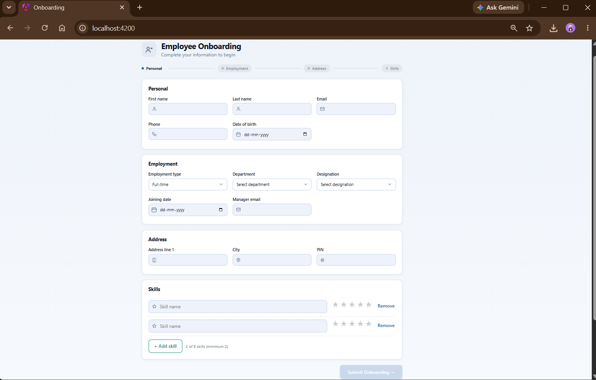
*Single page with the Personal, Employment, Address and Skills sections. Submit is disabled until the form is valid.*

### 2. Errors appear only after a field is touched
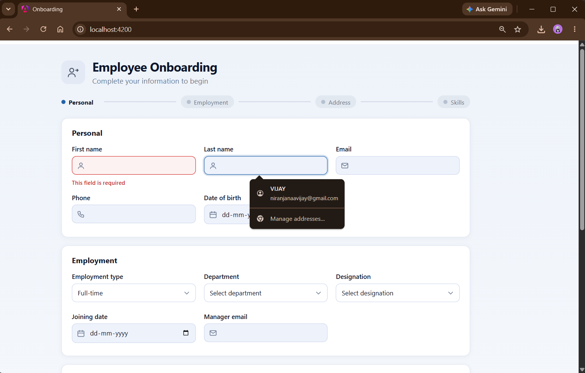
*Only the touched field shows its error; untouched fields stay clean (VR-1).*

### 3. Name validation
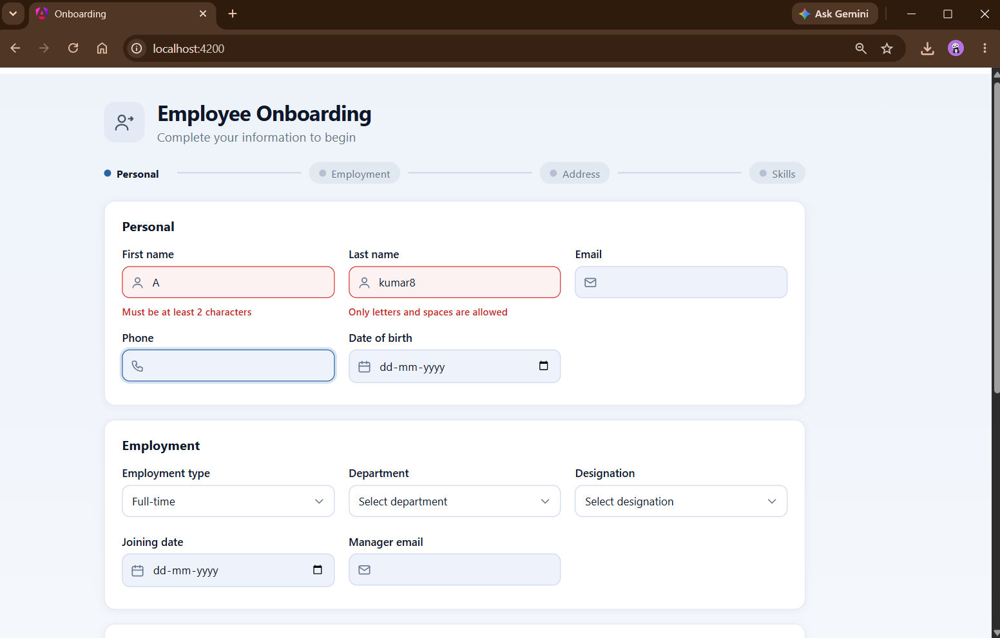
*Length and "letters and spaces only" messages produced by the schema (VR-1).*

### 4. Async email check in progress
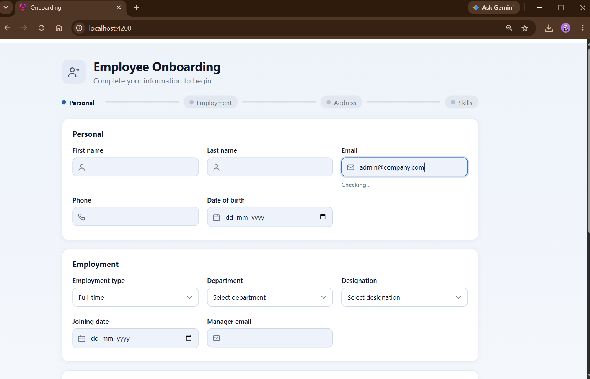
*"Checking..." is displayed while the fake API responds, and Submit stays disabled (VR-2).*

### 5. Duplicate email rejected
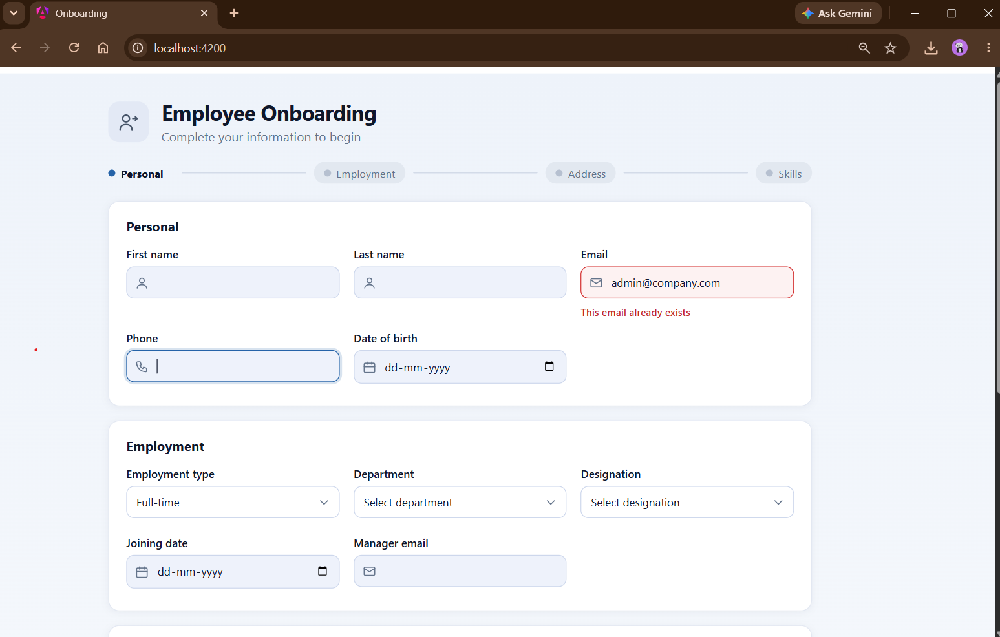
*`admin@company.com` is rejected by the interceptor-backed check (VR-2).*

### 6. Phone, PIN and age rules
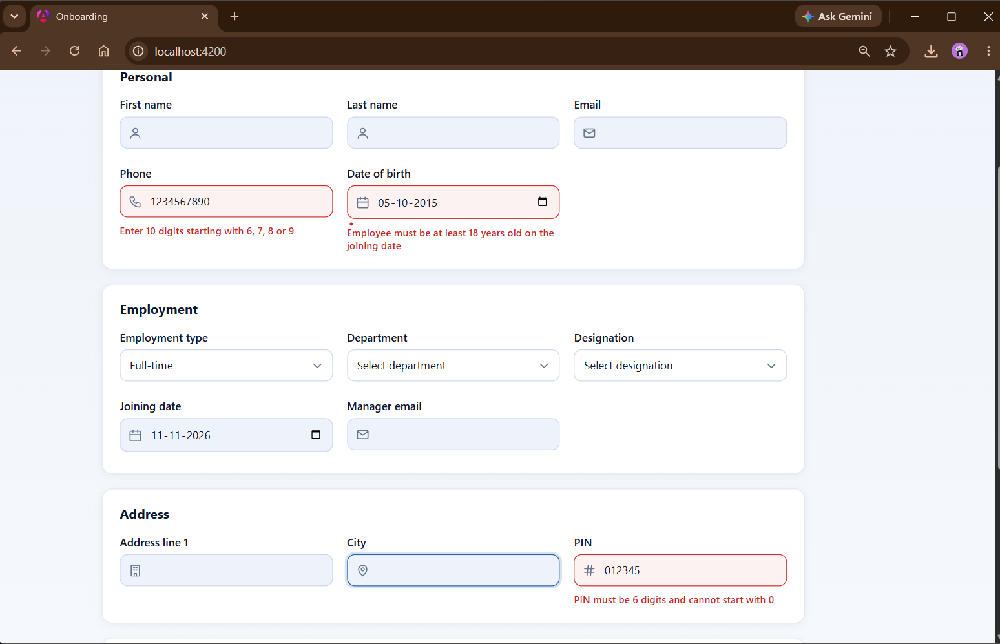
*Invalid phone, a PIN starting with 0, and an employee under 18 on the joining date (VR-3, VR-4, VR-7).*

### 7. Conditional end date
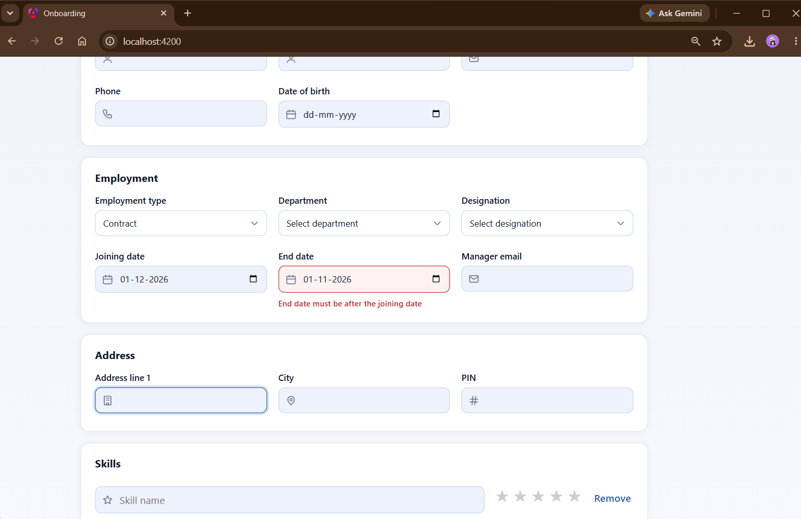
*The end date appears only for Contract and Intern, and must be after the joining date (VR-5).*

### 8. Department and designation
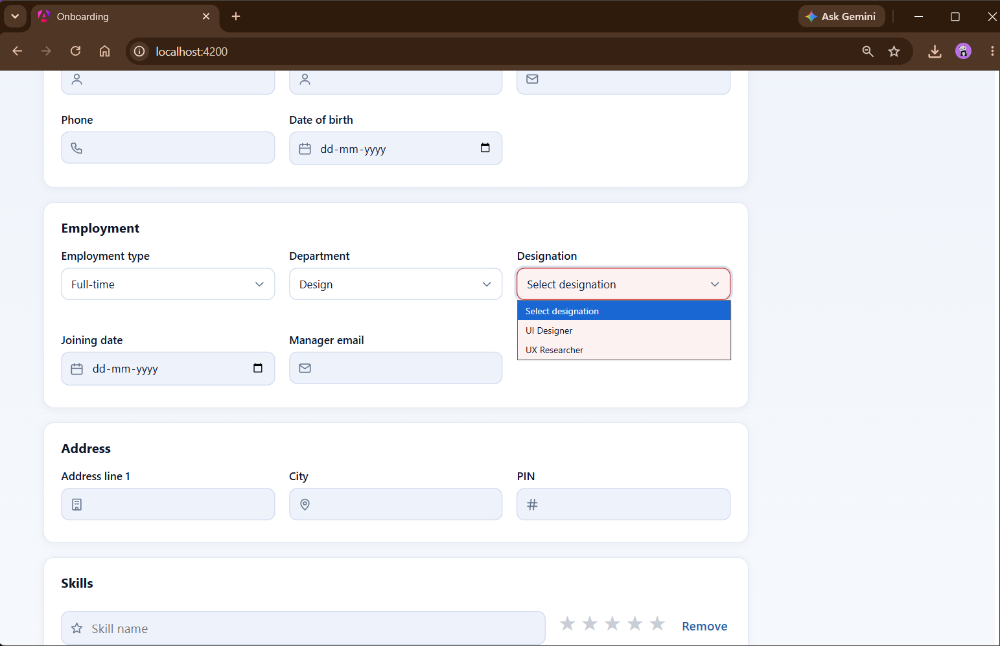
*Designation options depend on the department and are cleared when the department changes.*

### 9. Skills validation
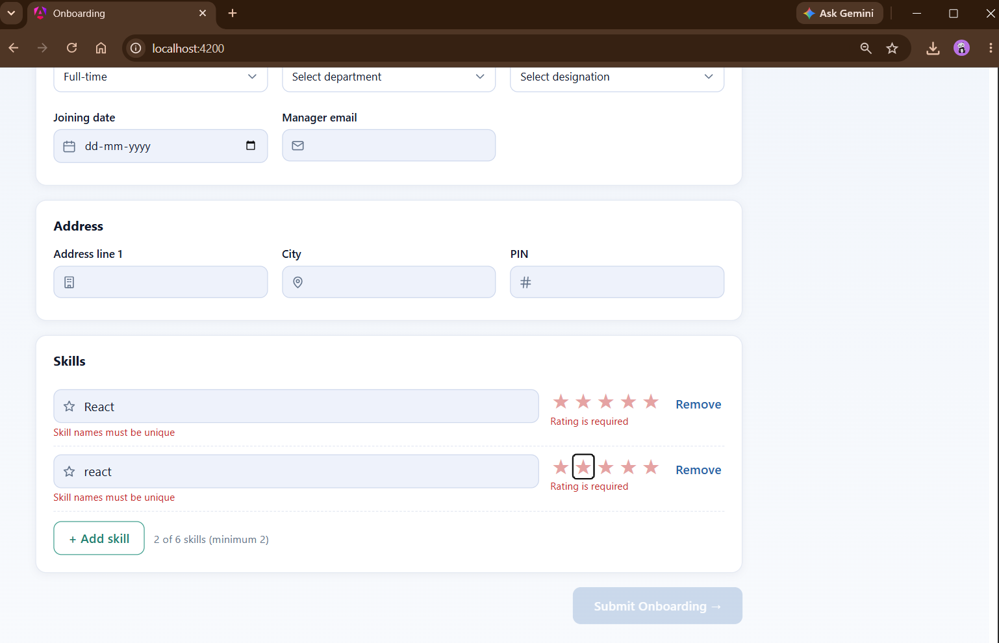
*Unique names, required rating and the 2 to 6 skills limit (VR-8), with add and remove.*

### 10. Valid form
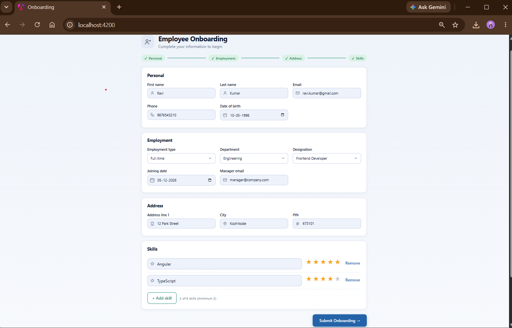
*With all rules satisfied and no check running, Submit becomes enabled.*

### 11. Success and reset
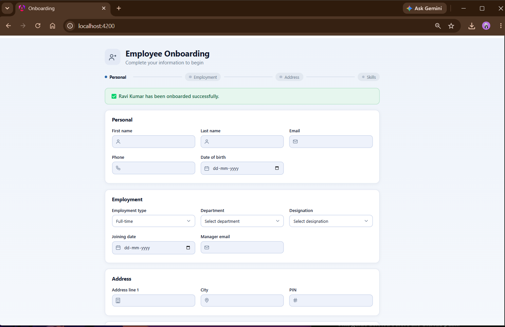
*A confirmation with the employee's full name is shown and the form resets.*

---

## Author

**[Niranjana Vijay K]**
